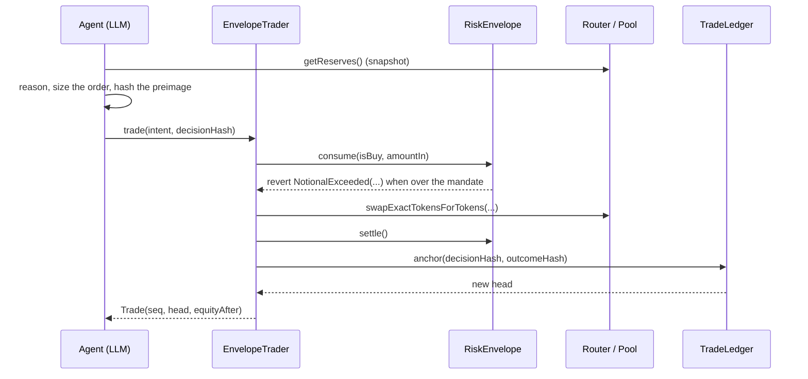

# Envelope

**An autonomous trading agent that cannot break its mandate.**

Envelope is a trading agent for HSK Chain whose every order must satisfy a signed, on-chain risk mandate, and whose every decision lands in a public hash chain. The agent can reason as freely as any LLM. It cannot widen its own limits, and it cannot quietly forget a loss.

Built for the **HashKey Chain Horizon Hackathon (India, Mumbai edition)**, Track 1: AI Agent Trading.

- Live on **HSK Chain testnet (chainId 133)** with real transactions
- 13 contract tests passing against a fork of HSK Chain mainnet, using the real HSKSwap contracts
- TypeScript end to end: Solidity contracts, Node agent, React desk
- MIT licensed

---

## Proof of work

Every transaction below is real, on HSK Chain testnet. Explorer base: `https://testnet-explorer.hskchain.net`.

### Deployed contracts

| Contract | Address | Purpose |
|---|---|---|
| `RiskEnvelope` | [`0x7b67AAd8eB08eF74EFe101325600B16dc5f95FFa`](https://testnet-explorer.hskchain.net/address/0x7b67AAd8eB08eF74EFe101325600B16dc5f95FFa) | Signed EIP-712 risk mandate, enforced against live reserves |
| `EnvelopeTrader` | [`0xECf9c42e8beFB1b9508B9430D536BB369F7F9246`](https://testnet-explorer.hskchain.net/address/0xECf9c42e8beFB1b9508B9430D536BB369F7F9246) | The only address that can move funds |
| `TradeLedger` | [`0xD41eF582Cf592D7B67803864c271519fCbF620ac`](https://testnet-explorer.hskchain.net/address/0xD41eF582Cf592D7B67803864c271519fCbF620ac) | Append-only hash chain of decisions |
| Venue (`MiniDEX`) | [`0x048475cf2731ff2c032c7938d3e358eeeb6cc4a4`](https://testnet-explorer.hskchain.net/address/0x048475cf2731ff2c032c7938d3e358eeeb6cc4a4) | Factory and router, Uniswap V2 surface |
| Pool (WHSK/dUSD) | [`0xA92D72d226cb655C1D25bDf2690d5E3D9Be26da6`](https://testnet-explorer.hskchain.net/address/0xA92D72d226cb655C1D25bDf2690d5E3D9Be26da6) | Seeded 20 WHSK against 2 dUSD |
| WHSK | [`0xf0F96c100e7A218aCFF1A6b3d069e288a3fa7269`](https://testnet-explorer.hskchain.net/address/0xf0F96c100e7A218aCFF1A6b3d069e288a3fa7269) | Base asset, 18 decimals |
| dUSD | [`0x0741DE74e8A69dB4B5Ef569e6f0d88812cA0672d`](https://testnet-explorer.hskchain.net/address/0x0741DE74e8A69dB4B5Ef569e6f0d88812cA0672d) | Quote asset, 6 decimals |

### Wallet

| Role | Address |
|---|---|
| Deployer, executor, current envelope owner | [`0x696e224Ff058656cF337c72eeDCF7C2b24aD96Ce`](https://testnet-explorer.hskchain.net/address/0x696e224Ff058656cF337c72eeDCF7C2b24aD96Ce) |

That key lives only in `~/envelope/.env`, mode 600, gitignored, never committed. It is a testnet key. Ownership can be handed to any EIP-1193 wallet with `pnpm --filter @envelope/contracts handoff`, after which the deploy key can no longer install a mandate.

### Evidence

| What it proves | Transaction |
|---|---|
| Protocol deployed (`RiskEnvelope`, 1.51M gas) | [`0x2b768c38…ab82874`](https://testnet-explorer.hskchain.net/tx/0x2b768c3866afd4fe998f90a358db8a77bd573abdfb63792f9075c62deab82874) |
| Venue deployed and pair created | [`0xd1a9627d…63a6a41`](https://testnet-explorer.hskchain.net/tx/0xd1a9627d287a9fd43d001617031f53a1e106cc561f5999c6ad5b7e6a163a6a41) |
| Mandate v1 signed and installed | [`0x1ec17966…e583b`](https://testnet-explorer.hskchain.net/tx/0x1ec17966688df7e427ecdcfd9b9b7b345765e743506e536114900966277e583b) |
| Mandate v2, rewritten by the operator | [`0xb4155d33…5c573`](https://testnet-explorer.hskchain.net/tx/0xb4155d3328e7fa977275337d05c192285eb119726e2c4e4afe52185dd435c573) |
| A trade the agent was allowed to take (status 1) | [`0x64b843c3…39f7a9`](https://testnet-explorer.hskchain.net/tx/0x64b843c399818856419f6f3e06fda2534d4b15b4dc11c647ab4dbd2e2b39f7a9) |
| **An order the chain refused** (status 0, `NotionalExceeded(600000, 150000)`) | [`0x17537070…d478712`](https://testnet-explorer.hskchain.net/tx/0x17537070a513d5dd38c29eedc031470c3226914906ee194e8a3d7b40ed478712) |

Verify the last one yourself: the receipt status is `0`. The transaction was sent by the agent, mined, and reverted by the envelope. Nothing in the UI prevented it.

### Verify it without trusting this README

The explorer URL printed in the HSK docs (`https://testnet-explorer.hsk.xyz`) returns 404 for chain 133 addresses. The working indexer for this chain is the one registered in [`ethereum-lists/chains`](https://github.com/ethereum-lists/chains/blob/master/_data/chains/eip155-133.json): **`https://testnet-explorer.hskchain.net`**. Every link in this README uses that host and was checked against its API.

The proof does not depend on any explorer. Everything below reads straight from the RPC:

```bash
bash scripts/verify-proof.sh
```

```
rpc: https://testnet.hsk.xyz
chain id: 133

== deployed code ==
  Envelope 0x7b67AAd8eB08eF74EFe101325600B16dc5f95FFa bytes=6529
  Ledger 0xD41eF582Cf592D7B67803864c271519fCbF620ac bytes=1271
  Trader 0xECf9c42e8beFB1b9508B9430D536BB369F7F9246 bytes=3998

== ledger state ==
  links anchored: 31
  head: 0x457c6d80655f6c53541b478dcfb3d22e3868d0fcb2738363bb45bd66a767ec44
  envelope owner: 0x696e224ff058656cf337c72eedcf7c2b24ad96ce

== transactions ==
  protocol deploy                    success block 34877704 gas 1507121  0x2b768c3866afd4fe…
  venue + pair                       success block 34877701 gas 754785   0xd1a9627d287a9fd4…
  mandate v1                         success block 34877709 gas 276878   0x1ec17966688df7e4…
  mandate v2                         success block 34878054 gas 89078    0xb4155d3328e7fa97…
  allowed trade                      success block 34877901 gas 260252   0x64b843c399818856…
  order the chain refused            REVERTED block 34878381 gas 70003   0x17537070a513d5dd…
```

One more check with nothing but curl, if you prefer:

```bash
curl -s -X POST https://testnet.hsk.xyz \
  -H 'content-type: application/json' \
  --data '{"jsonrpc":"2.0","id":1,"method":"eth_getTransactionReceipt",
           "params":["0x17537070a513d5dd38c29eedc031470c3226914906ee194e8a3d7b40ed478712"]}' \
  | jq '{status: .result.status, block: .result.blockNumber, gasUsed: .result.gasUsed}'
```

### State at the time of writing

Pulled from the running agent (`GET /api/state`, `GET /api/verify`):

- **31 ledger links**, every one recomputed and matching the on-chain head `0x457c6d80655f6c53541b478dcfb3d22e3868d0fcb2738363bb45bd66a767ec44`
- **35 decisions** recorded so far: fills, refusals and orders the envelope rejected
- Desk equity 0.613642 dUSD, position under the 40% cap, mandate nonce 2

The ledger keeps growing while the agent runs, so treat those numbers as a snapshot rather than a live claim. Re-run `GET /api/verify` or `scripts/verify-proof.sh` to check the chain from scratch.

---

## The problem

Every "AI trading agent" shipping today enforces risk in one of two places: a database owned by the operator, or a sentence in a prompt. Both are unverifiable. When the agent loses money there is no artifact that proves what it knew, what it intended, and what it was allowed to do. The risk limits are a promise, not a constraint.

Envelope moves the limits into a contract and the reasoning into a ledger. Being wrong stays possible. Being unbounded, or quietly rewriting the record afterwards, does not.

## The three primitives

| Primitive | Contract | Guarantee |
|---|---|---|
| **Mandate** | `RiskEnvelope.sol` | The owner signs an EIP-712 envelope. Every limit is checked against live pool reserves and live balances at execution time. A breach is a reverted transaction. |
| **Desk** | `EnvelopeTrader.sol` | The only address that can move funds. It authorises, swaps, re-baselines equity, then anchors the decision, all inside one transaction. |
| **Ledger** | `TradeLedger.sol` | Append-only hash chain over decisions, outcomes and refusals. Losses included. |

Enforced on-chain, per order:

- target pair, and therefore the target asset (changing it requires a new signature)
- maximum notional per trade
- maximum position as a share of equity
- maximum daily loss measured against the day's opening equity
- maximum trades per hour
- per-trade slippage band, computed from reserves in exact integer maths
- hard expiry
- one authorised executor, plus a strictly increasing nonce so an old mandate cannot be replayed

## Architecture

```
                    ┌──────────────────────────────────────────────┐
                    │  Desk (Vite + React + TypeScript)            │
                    │  mandate meters · decision feed · receipts   │
                    │  connect wallet → eth_signTypedData_v4       │
                    └───────────────┬──────────────────────────────┘
                                    │ REST
                    ┌───────────────▼──────────────────────────────┐
                    │  Agent (Node + TypeScript)                   │
                    │  snapshot → inference → size → submit        │
                    │  exact-integer slippage floor · JSONL record │
                    └───┬───────────────────────────┬──────────────┘
                        │ read reserves             │ trade()
        ┌───────────────▼──────────┐   ┌────────────▼─────────────────────┐
        │  HSKSwap / MiniDEX pair  │   │  EnvelopeTrader                  │
        │  Uniswap V2 getReserves  │◄──┤  1 consume()  2 swap()           │
        └──────────────────────────┘   │  3 settle()   4 anchor()         │
                                       └────┬──────────────────┬──────────┘
                                            │                  │
                                ┌───────────▼──────┐  ┌────────▼─────────┐
                                │  RiskEnvelope    │  │  TradeLedger     │
                                │  EIP-712 mandate │  │  hash chain      │
                                └──────────────────┘  └──────────────────┘
```



### Why the order of operations matters

The decision hash is committed on-chain **before** the first external swap call, inside the same transaction. That is what makes the record tamper-evident: a decision cannot be back-filled after its outcome is known, because the head it chains to already existed.

```solidity
// contracts/EnvelopeTrader.sol
envelope.consume(intent.isBuy, intent.amountIn);                    // 1. policy gate
uint256[] memory amounts = router.swapExactTokensForTokens(...);    // 2. money
envelope.settle();                                                  // 3. re-baseline
head = ledger.anchor(decisionHash, outcomeHash);                    // 4. the record
```

## How the mandate is enforced

`consume()` is the whole argument in one function: it reads live reserves, projects the position after the fill, and reverts with a named error.

```solidity
// contracts/RiskEnvelope.sol (abridged)
function consume(bool isBuy, uint256 amountIn) external returns (uint256 notionalQuote) {
    Mandate storage m = _mandate;
    if (!active) revert EnvelopeInactive();
    if (msg.sender != m.account) revert NotAccount(msg.sender);
    if (block.timestamp > m.expiry) revert EnvelopeExpired(m.expiry);

    (uint256 quoteReserve, uint256 baseReserve) = _reserves(m);
    if (quoteReserve == 0 || baseReserve == 0) revert NoLiquidity();

    if (tradesInHour + 1 > m.maxTradesPerHour) revert RateLimited(tradesInHour, m.maxTradesPerHour);

    uint256 equityNow = _equityWith(m, quoteReserve, baseReserve);
    uint256 baseValue = (IERC20Minimal(m.baseToken).balanceOf(m.account) * quoteReserve) / baseReserve;

    uint256 projectedBaseValue;
    if (isBuy) {
        notionalQuote = amountIn;
        projectedBaseValue = baseValue + amountIn;
    } else {
        notionalQuote = (amountIn * quoteReserve) / baseReserve;
        projectedBaseValue = baseValue > notionalQuote ? baseValue - notionalQuote : 0;
    }

    if (notionalQuote > m.maxNotionalQuote) revert NotionalExceeded(notionalQuote, m.maxNotionalQuote);

    uint256 projectedBps = (projectedBaseValue * 10_000) / equityNow;
    if (projectedBps > m.maxPositionBps) revert PositionExceeded(projectedBps, m.maxPositionBps);

    _rollDay(equityNow);
    if (equityNow < dayStartEquity && dayStartEquity > 0) {
        uint256 lossBps = ((dayStartEquity - equityNow) * 10_000) / dayStartEquity;
        if (lossBps >= m.maxDailyLossBps) revert DailyLossBreached(lossBps, m.maxDailyLossBps);
    }

    tradesInHour += 1;
    emit Consumed(isBuy, notionalQuote, tradesInHour);
}
```

Every violation is a distinct error carrying its arguments, so the UI can print `NotionalExceeded(600000, 150000)` instead of "transaction failed". That is the difference between a demo and a diagnosis.

### The agent cannot widen its own slippage

The trader recomputes the expected output from reserves at trade time and rejects any floor looser than the mandate allows. The agent's `minAmountOut` is a bid, not a setting.

```solidity
// contracts/EnvelopeTrader.sol
uint256 expectedOut = _expectedOut(m.pair, tokenIn, intent.amountIn);
uint256 mandateFloor = (expectedOut * (10_000 - m.maxSlippageBps)) / 10_000;
if (intent.minAmountOut < mandateFloor) revert SlippageBandViolation(intent.minAmountOut, mandateFloor);
```

The agent mirrors that formula in integers so it never trips the band on a rounding artefact, and it quotes from reserves read *after* the model call rather than the snapshot the model reasoned about. That second part was a real bug found on testnet: the pool moved during inference and the floor went stale.

```ts
// agent/src/agent.ts
const fresh = early ? null : await readPosition();   // reserves after inference
const rawQuote = fresh?.quoteReserve ?? position.quoteReserve;
const rawBase = fresh?.baseReserve ?? position.baseReserve;
const rIn = isBuy ? rawQuote : rawBase;
const rOut = isBuy ? rawBase : rawQuote;

const inFee = amountIn * 997n;
const expectedRaw = rIn > 0n && rOut > 0n ? (inFee * rOut) / (rIn * 1000n + inFee) : 0n;
const floorRaw = (expectedRaw * BigInt(10_000 - limits.maxSlippageBps)) / 10_000n;
minAmountOut = floorRaw > 0n ? floorRaw + 1n : 0n;
```

### The ledger

```solidity
// contracts/TradeLedger.sol
newHead = keccak256(abi.encodePacked(prev, decisionHash, outcomeHash, ts, seq));
```

Only the trader may write, so the record is produced by the same transaction that moved the money. `recompute()` is also exposed on-chain, so a third party can verify a link without trusting this repository's code.

```
GET /api/verify
{
  "count": 29,
  "ok": true,
  "onChainHead": "0xc33769b6…1c58",
  "recomputedHead": "0xc33769b6…1c58",
  "brokenAt": null
}
```

The preimage behind each decision lives in `agent/data/*.jsonl`: market snapshot, model, thesis, confidence, sizes, reasoning hash. Recompute `keccak256` of the canonical JSON and compare it to the anchored value.

## Wallet-signed mandates

The mandate is EIP-712 typed data. Any EIP-1193 wallet can be the owner, and `setMandate` accepts any relayer as long as the signature checks out, so the desk signs in MetaMask while the agent pays the gas.

```ts
// web/src/App.tsx, using the helpers in api.ts
const prepared = await prepareMandate(patch);                       // POST /api/mandate/prepare
const signature = await signTypedData(wallet, prepared.typedData);  // eth_signTypedData_v4
await submitMandate(prepared.mandate, signature);                   // POST /api/mandate/submit
```

```ts
// agent/src/envelope.ts
export const MANDATE_TYPES = {
  Mandate: [
    { name: 'account', type: 'address' },
    { name: 'executor', type: 'address' },
    { name: 'pair', type: 'address' },
    { name: 'baseToken', type: 'address' },
    { name: 'quoteToken', type: 'address' },
    { name: 'maxPositionBps', type: 'uint16' },
    { name: 'maxDailyLossBps', type: 'uint16' },
    { name: 'maxSlippageBps', type: 'uint16' },
    { name: 'maxTradesPerHour', type: 'uint16' },
    { name: 'maxNotionalQuote', type: 'uint256' },
    { name: 'expiry', type: 'uint64' },
    { name: 'nonce', type: 'uint64' },
  ],
};
```

To prove the browser path without a browser, `agent/scripts/sign-mandate.ts` builds the same payload, signs it with the owner key, and relays it through the same endpoint.

## Tech stack

**Contracts.** Solidity 0.8.24, Hardhat 2.22, OpenZeppelin 5 (EIP712, ECDSA, ERC20, Ownable), `viaIR` with the optimizer at 200 runs. Uniswap V2 interfaces are written by hand so the same trader works against HSKSwap and against the local venue.

**Agent.** Node 23, TypeScript, viem (typed reads and writes, EIP-712 signing), Express, dotenv. Inference goes through any OpenAI-compatible endpoint; this build points at Particle.ai with `deepseek-v41-flash-1017` and falls back to a deterministic policy that is labelled in the record.

**Desk.** Vite 6, React 18, TypeScript, a hand-written CSS design system. No UI framework and no webfont CDN, so it renders correctly on venue wifi. Playwright drives the flows and the layout checks.

**Storage.** JSONL decision records keyed to the deployment, so a fresh chain never shows another chain's history.

## Repository layout

```
contracts/
  contracts/
    RiskEnvelope.sol        EIP-712 mandate, live-reserve enforcement
    EnvelopeTrader.sol      consume → swap → settle → anchor
    TradeLedger.sol         append-only hash chain
    mocks/MiniDEX.sol       self-contained Uniswap V2 venue (factory, pair, router)
    mocks/MockWHSK.sol      WETH9 stand-in for the local demo
    mocks/TestToken.sol     mintable ERC20 for seeding
    interfaces/IUniswapV2.sol
  scripts/
    deploy.ts               mainnet, against the real HSKSwap router
    deploy-testnet.ts       self-contained venue plus protocol on chain 133
    deploy-local.ts         local chain, fresh deployment each run
    handoff-owner.ts        move envelope ownership to a human wallet
  test/envelope.spec.ts     13 tests against a mainnet fork
  deployments/testnet.json  live testnet addresses

agent/
  src/
    agent.ts                the cycle: snapshot, reason, size, submit, anchor
    envelope.ts             mandate reads, EIP-712 payloads, trade, refuse, revert decoding
    market.ts               reserves, reference price, flow window, equity
    particle.ts             OpenAI-compatible inference with a labelled fallback
    ledger.ts               canonical preimage and hash chain verification
    noise.ts                labelled synthetic flow so the pool actually moves
    server.ts               REST surface
  scripts/                  probe-trade.ts, sign-mandate.ts, probe-noise.ts

web/
  src/
    App.tsx                 the desk
    api.ts                  typed client, EIP-1193 helpers, chain switching
    components/ui.tsx       Card, Chip, Meter, Hash, Sparkline
    styles.css              design tokens and layout
```

## Run it

```bash
cp .env.example .env       # add PARTICLE_API_KEY, then: pnpm wallet
pnpm install
bash scripts/demo.sh       # local chain + deploy + agent + desk
```

Desk on `http://localhost:5199`, agent API on `http://127.0.0.1:8788`.

Three things to try:

1. **Run one cycle.** The agent reads the pool, asks the model, sizes an order, submits it, anchors the receipt.
2. **Ask for 4× the mandate.** A real oversized order is submitted. The chain rejects it with `NotionalExceeded`.
3. **Type a change.** "be more aggressive, 8 trades an hour." The model proposes a mandate patch; signing it is a separate, explicit act.

### Against the live testnet

```bash
# .env
NETWORK=testnet
CHAIN_ID=133
RPC_URL=https://testnet.hsk.xyz
EXPLORER_URL=https://testnet-explorer.hskchain.net
```

```bash
cd agent && AUTO_START=true npx tsx src/index.ts
cd web   && node ./node_modules/vite/bin/vite.js --port 5199
```

```bash
curl -s localhost:8788/api/state  | jq '{nonce: .mandate.nonce, links: .ledger.count}'
curl -s localhost:8788/api/verify | jq '{count, ok}'
curl -s -X POST localhost:8788/api/tick  -H 'content-type: application/json' -d '{"noise":true}'
curl -s -X POST localhost:8788/api/break -H 'content-type: application/json' -d '{"sizePct":400}'
```

## API

| Method | Path | What it does |
|---|---|---|
| `GET` | `/api/health` | Liveness, network, chain id |
| `GET` | `/api/state` | Mandate, position, market, ledger, records |
| `GET` | `/api/records` | Decision records |
| `GET` | `/api/verify` | Recompute the whole chain and compare heads |
| `POST` | `/api/tick` | Run one cycle (`noise`, `forceAction`, `forceSizePct`) |
| `POST` | `/api/break` | Submit an order outside the mandate (`sizePct`) |
| `POST` | `/api/chat` | Translate plain English into a mandate patch |
| `POST` | `/api/mandate` | Sign and install with the server key (demo fallback) |
| `GET` | `/api/wallet` | Owner of record, chain id, envelope address |
| `POST` | `/api/mandate/prepare` | Build the next mandate, return EIP-712 typed data |
| `POST` | `/api/mandate/submit` | Relay a wallet-signed mandate |
| `POST` | `/api/start`, `/api/stop` | Control the loop |

## Tests

```bash
pnpm test
```

```
✔ seeds a real HSKSwap pair and reports equity
✔ rejects a mandate signed by the wrong key
✔ installs the signed mandate and reports position
✔ executes a trade inside the envelope and anchors it
✔ reverts with a named error when the order breaches the notional cap
✔ reverts when the order breaches the position ceiling
✔ rate limits the agent
✔ rejects an expired mandate
✔ rejects anyone who is not the executor
✔ refuses a slippage floor looser than the mandate band
✔ reverts on stale nonce so an old mandate cannot be replayed
✔ hands ownership to a human wallet and locks the deployer out
✔ keeps the ledger chain verifiable link by link
13 passing
```

The suite runs against a **fork of HSK Chain mainnet** and seeds a pair through the **live HSKSwap factory and router** (`0x75e5da97…4119`, `0x569a9C08…4439`), so the trader is exercised against the real contracts rather than a mock of them.

## Mainnet

`contracts/scripts/deploy.ts` targets chain 177 and the real HSKSwap router. Validate configuration without sending anything:

```bash
DRY_RUN=1 QUOTE_TOKEN=0x054ed45810DbBAb8B27668922D110669c9D88D0a \
  pnpm --filter @envelope/contracts exec hardhat run scripts/deploy.ts --network hsk
```

Mainnet gas is about 0.02 gwei, so a full deploy costs roughly **0.00014 HSK**. The mainnet deployment has **not** been executed yet. The testnet one has.

## Quirks of the HSK testnet RPC

Found while deploying and worked around in code, so the demo does not depend on them:

- **Reads lag writes by a few blocks.** A `view` call immediately after a transaction can return pre-transaction state. The deploy script takes the pair address from the `PairCreated` event instead of reading it back, and polls for mandate activation.
- **`eth_estimateGas` under-reports for deploys and for calls that deploy a contract.** `createPair` was estimated at 23k gas. Every transaction sets an explicit ceiling.
- **Type-2 transactions are rejected** with "replacement transaction underpriced" even with a clean nonce. All writes use a legacy `gasPrice` of 2 gwei.
- **Mined-but-reverted receipts do not throw** in viem. The agent checks `receipt.status`, replays the call to recover the named error, and keeps the transaction hash so every refusal has an explorer link.

## Honest limitations

- **The venue is thin.** HSKSwap's live factory holds three pairs and the only funded one holds about one cent of liquidity, so a taker agent has nothing to trade there. The testnet demo deploys its own venue and seeds it. On mainnet the same contracts point at the real HSKSwap router with a deployer-seeded pool.
- **Flow is synthetic in the demo.** `NOISE_TRADER=true` makes small *real* swaps so the pool moves and the agent has something to react to. Every record produced that way is still a real on-chain action, and the flag is documented here rather than hidden.
- **The model is not the claim.** The agent will be wrong. The claim is that being wrong is bounded, and that every wrong decision sits in the record with its reasoning attached.
- **Server-side signing is a demo convenience.** The agent holds an owner key so the loop can run unattended. Hand ownership to a wallet with `handoff` and the server key stops being able to install a mandate.
- **No external oracle in the loop.** The venue's own reserves are the only price the trader can actually transact at. A Supra feed is wired as an optional cross-check, not as the trading signal.
- **HSP is not used.** This is a Track 1 submission. The mandate object is deliberately shaped so the same envelope can be expressed as an HSP mandate if the desk is extended to Track 2.

## Fork and contribute

```bash
git clone https://github.com/<you>/envelope
cd envelope
pnpm install
cp .env.example .env
pnpm wallet                # generates a deployer key into .env
pnpm test                  # 13 tests against a mainnet fork
bash scripts/demo.sh       # full local stack
```

| Command | What it does |
|---|---|
| `pnpm test` | Contract suite on an HSK mainnet fork |
| `bash scripts/verify-proof.sh` | Check every proof claim straight from the chain |
| `bash scripts/check-links.sh` | Assert every explorer link in the docs is really indexed |
| `pnpm demo` | Chain, deploy, agent and desk in one command |
| `pnpm --filter @envelope/contracts deploy:testnet` | Full testnet deployment |
| `pnpm --filter @envelope/contracts handoff` | Give envelope ownership to a wallet |
| `pnpm --filter @envelope/agent exec tsx scripts/sign-mandate.ts` | Sign a mandate the way the browser does |
| `node web/scripts/ui-check.mjs` | Drive the desk in Chrome and assert the flows |

Conventions worth keeping:

- **Named errors, never bare requires.** Every new limit gets a custom error with arguments so the UI can explain the refusal.
- **One transaction per decision.** If an operation needs two, the ordering has to make the decision provable.
- **The agent proposes, the owner grants.** Nothing the agent holds should be able to raise its own limits.
- **Test against the real contracts.** Fork HSK mainnet rather than mocking HSKSwap.
- **Label synthetic behaviour.** If something in the demo is not real market flow, say so here and in the UI.

### Features worth building next

Roughly in order of value to a judge, then to a user:

1. **HSP settlement on the same envelope.** Let the agent pay for its own data and inference under the same signed limits, with `attests:kyc` as a capability. This is the bridge from Track 1 to Track 2.
2. **Multi-venue routing.** A mandate per venue with a shared equity base, so the agent can route across HSKSwap pairs while the desk still reports one drawdown number.
3. **Supra oracle as a second opinion.** Refuse to trade when the pool deviates from the oracle beyond a threshold. A manipulation guard that lives in the mandate, not the prompt.
4. **Mandate templates as a marketplace.** Publish a mandate and policy pair, let others run it under their own capital and their own signature.
5. **Loss attribution.** Decompose realized PnL into spread, fee, adverse selection and model error, per decision. The ledger already records the inputs.
6. **Session keys with scoped expiry.** Replace the single executor key with short-lived per-cycle keys, so a leaked key expires in minutes.
7. **Revocation UX.** A one-click `revoke()` in the desk, plus a watcher that alerts when a mandate approaches its daily loss cap.
8. **Backtesting over the ledger.** Replay recorded snapshots through a new policy and diff the outcomes. Only possible because decisions are recorded before outcomes.
9. **Cross-chain mandate via CCIP.** One signed envelope governing positions on two chains, with the ledger anchored on HSK.
10. **A verifier in another language.** A small Rust or Go binary that recomputes the chain from the JSONL and the `Anchored` events, so verification does not depend on this TypeScript.

### Pull requests

- Open an issue describing the limit or behaviour before a large PR.
- Keep contract changes covered by a fork test that fails without the change.
- Do not commit `.env`, `agent/data/*.jsonl`, or deployment files other than `contracts/deployments/testnet.json`.
- Update this README when you add an endpoint, a limit, or a quirk.

## License

MIT. See [LICENSE](LICENSE).

---

**Built By Harish Kotra** | [harishkotra.me](https://harishkotra.me)

**Checkout my other builds** | [dailybuild.xyz](https://dailybuild.xyz)
